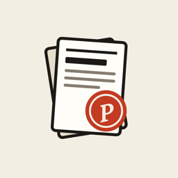
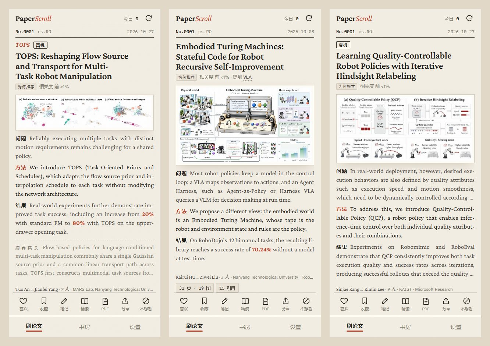

<p align="center">
  
</p>

<h1 align="center">PaperScroll</h1>

<p align="center">
  <b>Scroll arXiv like short videos — a private, self-hosted paper feed for your phone.</b><br>
  One paper per screen · the problem, method and result at a glance · recommendations that learn from you.
</p>

<p align="center">
  <a href="README.zh-CN.md">中文说明</a> ·
  <a href="docs/server.md">Server setup</a> ·
  <a href="docs/android.md">Android app</a> ·
  <a href="docs/how-it-works.md">How it works</a> ·
  <a href="docs/faq.md">FAQ</a>
</p>

<p align="center">
  
</p>

> **Status: actively maintained.** New features and fixes land regularly; see [CHANGELOG.md](CHANGELOG.md).
> Questions, bugs or ideas: open an issue or write to **kyyang26@m.fudan.edu.cn**.

---

## Why

Keeping up with arXiv means skimming hundreds of new titles a day. PaperScroll turns that into a feed you
can swipe through on the bus: every card shows the key figure and the three sentences of the abstract that
state the **problem**, the **method** and the **result**, so you can decide in a few seconds whether a paper
deserves a closer read. Your likes, saves and skips quietly steer what comes next.

Everything runs on a computer you own. There is no account, no cloud service and no LLM bill: papers come
straight from arXiv, embeddings are computed locally on the CPU, and the phone talks to your computer
over your private network (e.g. [Tailscale](https://tailscale.com)).

## Features

**Reading**
- Full-screen cards, one paper per swipe; pull down or tap ↻ for a fresh batch.
- *At a glance*: the problem / method / result sentences picked out of the abstract (verbatim, never invented),
  with numbers such as `+12.3%` or `2.5×` highlighted.
- The paper's key figure from the official arXiv HTML version; tap for a full-screen, zoomable view.
- Method name and paper type (benchmark, dataset, survey, real-robot, theory) as a kicker above the title.
- Venue stamp with its level, e.g. **CVPR 2026 · CCF-A · CORE A\***, from the CCF list and the CORE ranking.
- Citation counts and published venues from [OpenAlex](https://openalex.org) (optionally Semantic Scholar).
- Links to code and project pages found in the abstract; page and figure counts from the arXiv comment.
- *Close reading* sheet: the full abstract with each sentence coloured by its role, plus PDF / HTML / arXiv links.
- Paper and night themes, adjustable font size and density, justified text with proper English hyphenation.
- The interface is currently in Simplified Chinese (papers are shown in their original English); an English UI is on the roadmap.

**Recommending**
- Describe your research in one sentence; the feed ranks papers by semantic similarity (multilingual
  MiniLM embeddings), keyword match (SQLite FTS5 / BM25), freshness and venue quality.
- Learns from you: likes, saves and notes pull the profile towards similar work; "not interested" pushes away.
- Four knobs: recency, topical strictness, quality (accepted / highly cited) and novelty.
- Occasional *adjacent-field* cards to keep you from living in a bubble.
- Every card says why it was picked ("top 1% match · mentions *diffusion policy*").

**Keeping**
- Library of liked / saved / noted / hidden papers with margin notes.
- Export to BibTeX, Markdown, CSV or JSON, straight to the Android share sheet.
- Daily background sync of the categories you choose (9 AI/ML/CV/NLP/robotics/audio categories by default),
  keeping a rolling window (90 days by default; liked, saved and noted papers are never pruned).

**Running**
- One small Python server (FastAPI + SQLite) on Windows, Linux or macOS; about 0.7 GB on disk for
  ~50k papers, near-zero CPU when idle.
- Android app is a thin shell that loads the interface from your server, so UI updates need no reinstall.
- Also works in any browser (desktop or mobile) at the server's address.

## Architecture

```
 ┌───────────── your computer ─────────────┐          ┌──── your phone ────┐
 │ arXiv API ──► ingest ──► SQLite + FTS5   │          │                    │
 │ arXiv HTML ─► key figure, affiliations   │  private │  PaperScroll APK   │
 │ OpenAlex ───► citations, venue           │◄────────►│  (Capacitor shell) │
 │ fastembed ──► local embeddings (CPU)     │ network  │   or any browser   │
 │ FastAPI ────► /api/feed, /api/... + web/ │ Tailscale│                    │
 └──────────────────────────────────────────┘          └────────────────────┘
```

| Path | What |
|---|---|
| `server/` | Python backend: ingest, enrichment, ranking, HTTP API ([details](docs/how-it-works.md)) |
| `web/` | The interface — plain HTML/CSS/JS, no build step, served by the backend |
| `app/` | Android shell (Capacitor 7) and build scripts |
| `data/` | Created at runtime: database, figure cache, model, `config.json`, logs (git-ignored) |
| `docs/` | Guides |

## Quick start

You need: a computer that stays on (Windows 10/11, Linux or macOS), Python 3.11–3.12 with
[uv](https://docs.astral.sh/uv/), and — for the phone — a private network such as Tailscale.

```bash
git clone https://github.com/<you>/paperscroll.git
cd paperscroll/server
uv sync                      # creates server/.venv with the dependencies
uv run python run.py         # serves http://127.0.0.1:8765
```

Open <http://127.0.0.1:8765>, describe your research topic in one English sentence, and start scrolling.
The first start downloads the embedding model (~240 MB) and backfills the last 90 days of the default
categories (~50k papers, roughly 20–40 minutes depending on your connection); the feed works as soon as the
first papers are indexed.

Then:
1. **Keep it running** — [Windows scheduled task, Linux systemd or macOS launchd](docs/server.md#run-it-in-the-background).
2. **Reach it from the phone** — [expose it to your tailnet](docs/server.md#reach-it-from-your-phone) with `tailscale serve`.
3. **Install the app** — [build the APK](docs/android.md) pointing at that address, or simply open the address
   in your phone's browser and *Add to home screen*.

## Configuration

Most settings live in the app (*Settings*): research topic and keywords, the four ranking knobs, theme,
font size, arXiv categories, retention window and API keys. They are stored in `data/config.json` and the
database. See [docs/configuration.md](docs/configuration.md) for every option, including environment variables.

Optional free API keys make enrichment faster:
- **OpenAlex** (citations, venues) — <https://openalex.org/settings/api>. Without a key PaperScroll uses
  the small anonymous daily budget and backfills over a few days.
- **Semantic Scholar** (TL;DR summaries) — <https://www.semanticscholar.org/product/api>.

## Privacy and security

- Your topic, interactions and notes never leave your computer. Outgoing requests go only to arXiv,
  OpenAlex and (if configured) Semantic Scholar, and contain paper identifiers only.
- The server has **no authentication**. By default it listens on `127.0.0.1` only; expose it through a private
  network such as Tailscale, never directly to the internet. See [docs/server.md](docs/server.md#security).

## Roadmap

- [ ] English interface (i18n)
- [ ] Fallback key figure from the PDF for papers without an arXiv HTML version
- [ ] Optional on-device or local-LLM one-line summaries
- [ ] iOS shell, release-signed APK in GitHub Releases
- [ ] More sources (OpenReview, bioRxiv) and author/venue follow lists

Suggestions are welcome — open an issue.

## Contributing

Bug reports, ideas and pull requests are welcome; please read [CONTRIBUTING.md](CONTRIBUTING.md).
For anything else, contact **Kunyu Yang** at **kyyang26@m.fudan.edu.cn**.

## Acknowledgements

Inspired by [PaperDance](https://paperdance.org); PaperScroll is an independent project and not affiliated with it.
Data from [arXiv](https://arxiv.org) (thank you to arXiv for use of its open access interoperability),
[OpenAlex](https://openalex.org) and [Semantic Scholar](https://www.semanticscholar.org).
Venue levels from the [CCF recommended list](https://www.ccf.org.cn/) via
[CCFrank4dblp](https://github.com/WenyanLiu/CCFrank4dblp) and the [CORE rankings](https://portal.core.edu.au/conf-ranks/).
Third-party components are listed in [THIRD_PARTY_NOTICES.md](THIRD_PARTY_NOTICES.md).

## License

[MIT](LICENSE) © 2026 Kunyu Yang. Paper metadata, abstracts and figures belong to their authors and are shown
under arXiv's terms; PaperScroll only caches them locally for personal reading.
