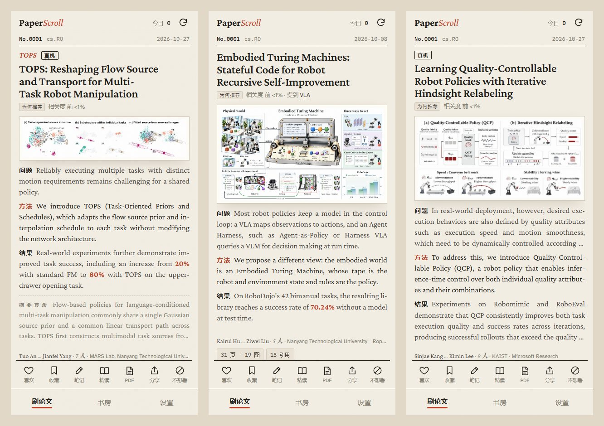

<p align="center">
  
</p>

<h1 align="center">PaperScroll</h1>

<p align="center">
  <b>像刷短视频一样刷 arXiv —— 部署在自己电脑上、在手机上读的私人论文流。</b><br>
  一屏一篇 · 问题 / 方法 / 结果一眼看懂 · 越刷越懂你
</p>

<p align="center">
  受 <a href="https://paperdance.org">PaperDance</a> 启发 · <a href="README.md">English</a> ·
  <a href="docs/server.md">服务端部署</a> ·
  <a href="docs/android.md">安卓 App</a> ·
  <a href="docs/how-it-works.md">原理</a> ·
  <a href="docs/faq.md">常见问题</a>
</p>

https://github.com/user-attachments/assets/83b980bd-9705-48e1-a686-40216ee145d5

<p align="center"><sub>▶ 1 分钟产品介绍（英文配音 + 中文字幕）</sub></p>

<p align="center">
  
</p>

> **项目持续更新中。** 更新记录见 [CHANGELOG.md](CHANGELOG.md)。
> 有问题、建议或反馈，欢迎提 Issue，或直接发邮件给我：**kyyang26@m.fudan.edu.cn**

---

## 这是什么

PaperScroll **受 [PaperDance（纸上跳舞）](https://paperdance.org) 启发而开发**。PaperDance 让我们看到，用「刷」的方式浏览新论文
可以很轻松；PaperScroll 在这个想法的基础上做成了一套开源、可自行部署的方案：完全运行在你自己的电脑上，
配有原生安卓 App，并加入了一些自己的功能（问题 / 方法 / 结果一眼看懂、会议级别、在本地学习你偏好的推荐）。


arXiv 每天上新几百篇，光看标题就要花很久。PaperScroll 把它变成一个可以上下滑的信息流：每张卡片给出论文的
关键配图，以及从摘要里挑出的**问题、方法、结果**三句话，几秒钟就能判断值不值得细读。你的喜欢、收藏和跳过会
悄悄调整之后推给你的内容。

所有东西都跑在你自己的电脑上：不需要注册账号、不依赖云服务、也不用付大模型的钱。论文直接来自 arXiv，
向量在本地 CPU 上计算，手机通过私有网络（推荐 [Tailscale](https://tailscale.com)）连到你的电脑。

## 功能

**阅读**
- 全屏卡片，一屏一篇；下拉或点右上角 ↻ 换一批。
- 「问题 / 方法 / 结果」三段：从摘要原文中挑句子（不改写、不编造），数字如 `+12.3%`、`2.5×` 会高亮。
- 论文关键图取自 arXiv 官方 HTML 版，点开可全屏放大。
- 标题上方显示方法名和论文类型（基准、数据集、综述、真机、理论）。
- 会议印章带级别，例如 **CVPR 2026 · CCF-A · CORE A\***（来自 CCF 推荐目录和 CORE 排名）。
- 引用数和正式发表出处来自 [OpenAlex](https://openalex.org)（可选 Semantic Scholar）。
- 摘要里的代码仓库、项目主页链接一键打开；从 arXiv 备注中读出页数和图数。
- 「精读」页：完整摘要按句子作用着色，附 PDF / HTML 全文 / arXiv 链接。
- 纸面 / 夜读两套主题，字号与信息量可调，英文两端对齐并正确断词。
- 界面目前为简体中文，论文内容保持英文原文。

**推荐**
- 用一句话描述你的研究方向；按语义相似度（多语言 MiniLM 向量）、关键词匹配（SQLite FTS5 / BM25）、
  新鲜度和发表质量综合排序。
- 会学习：喜欢、收藏、写笔记会把画像拉向相似论文，「不想看」会推开。
- 四个旋钮：时间、主题贴合度、成色（中稿 / 高引）、新鲜感。
- 不时插入「邻近领域」卡片，避免信息茧房。
- 每张卡都写明推荐理由，比如「相关度前 1% · 提到 *diffusion policy*」。

**收藏与导出**
- 书房：喜欢 / 收藏 / 笔记 / 不感兴趣分栏，支持写旁注。
- 导出 BibTeX、Markdown、CSV、JSON，可直接分享到微信、网盘等。
- 每天自动同步你选择的 arXiv 类目（默认 9 个 AI / 机器学习 / 视觉 / NLP / 机器人 / 音频类目），
  保留最近 90 天；喜欢、收藏、写过笔记的论文永不清理。

**运行**
- 一个轻量 Python 服务（FastAPI + SQLite），支持 Windows / Linux / macOS；约 5 万篇论文占用约 0.7 GB，
  空闲时几乎不占 CPU。
- 安卓 App 只是一个外壳，界面从你的电脑加载，**界面更新不用重装 App**。
- 任何浏览器（电脑或手机）打开服务器地址也能直接用。

## 快速开始

需要：一台常开的电脑（Windows 10/11、Linux 或 macOS）、Python 3.11–3.12 和 [uv](https://docs.astral.sh/uv/)；
手机端需要一个私有网络，比如 Tailscale。

```bash
git clone https://github.com/yanggoumao2/paperscroll.git
cd paperscroll/server
uv sync                      # 在 server/.venv 里安装依赖
uv run python run.py         # 启动服务 http://127.0.0.1:8765
```

浏览器打开 <http://127.0.0.1:8765>，用一句**英文**描述你的研究方向，就可以开始刷了。
第一次启动会下载向量模型（约 240 MB），并回填默认类目最近 90 天的论文（约 5 万篇，视网络大约半小时左右）；
建库过程中就可以开始使用。

接下来：
1. **让它常驻后台** —— [Windows 计划任务 / Linux systemd / macOS launchd](docs/server.md#run-it-in-the-background)
2. **让手机能访问** —— 用 `tailscale serve` [只暴露给自己的设备](docs/server.md#reach-it-from-your-phone)
3. **安装 App** —— 用你的地址[编译 APK](docs/android.md)；或者直接在手机浏览器打开地址，选择「添加到主屏幕」

国内用户：arXiv 和 OpenAlex 通常可以直连；首次下载模型（Hugging Face）可能需要代理，
启动前设置 `HTTPS_PROXY` 即可，或从别的机器拷贝 `data/models/`。

## 配置

大部分设置在 App 的「设置」页：研究课题和关键词、四个推荐旋钮、主题、字号、arXiv 类目、保留天数、API key。
所有选项和环境变量见 [docs/configuration.md](docs/configuration.md)。

两个可选的免费 key 能让补全更快：
- **OpenAlex**（引用数、发表出处）：<https://openalex.org/settings/api>。不填也能用，只是用共享的匿名额度，几天内补完。
- **Semantic Scholar**（TL;DR 一句话总结）：<https://www.semanticscholar.org/product/api>。

## 隐私与安全

- 你的课题、阅读记录和笔记只存在你自己的电脑上。对外请求只发往 arXiv、OpenAlex 和（若配置）Semantic Scholar，
  内容只有论文编号。
- 服务**没有登录认证**。默认只监听 `127.0.0.1`，请通过 Tailscale 等私有网络访问，不要直接暴露到公网。
  详见 [docs/server.md](docs/server.md#security)。

## 路线图

- [ ] 英文界面
- [ ] 没有 arXiv HTML 版的论文，从 PDF 中提取主图
- [ ] 可选的本地大模型一句话总结
- [ ] iOS 外壳；在 GitHub Releases 提供正式签名的 APK
- [ ] 更多来源（OpenReview、bioRxiv），关注作者 / 会议

欢迎在 Issue 里提需求。

## 参与与反馈

欢迎提交 Bug、建议和 Pull Request，请先看 [CONTRIBUTING.md](CONTRIBUTING.md)。
其他问题请联系 **杨昆谕（Kunyu Yang）**：**kyyang26@m.fudan.edu.cn**

## 致谢

灵感来自 [PaperDance](https://paperdance.org)；PaperScroll 是独立项目，与其无隶属关系。
数据来自 [arXiv](https://arxiv.org)（感谢 arXiv 提供开放获取接口）、[OpenAlex](https://openalex.org) 和
[Semantic Scholar](https://www.semanticscholar.org)。会议级别来自 [CCF 推荐目录](https://www.ccf.org.cn/)
（经 [CCFrank4dblp](https://github.com/WenyanLiu/CCFrank4dblp) 整理）和 [CORE 排名](https://portal.core.edu.au/conf-ranks/)。
第三方组件见 [THIRD_PARTY_NOTICES.md](THIRD_PARTY_NOTICES.md)。

## 许可证

[MIT](LICENSE) © 2026 Kunyu Yang。论文元数据、摘要和图片版权归原作者所有，按 arXiv 的条款展示；
PaperScroll 只在本地缓存，供个人阅读。
